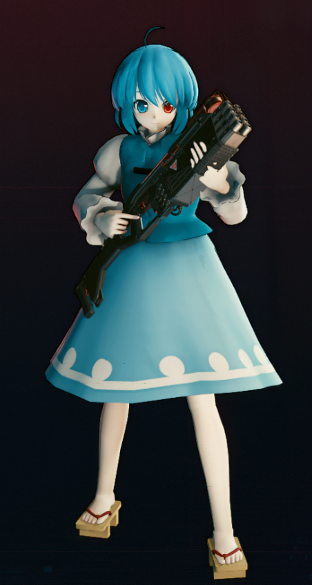

# 多多良小伞 · Cyberpunk 2077

给女 V 穿上多多良小伞的完整外观。第一人称低头可以看到青裙、白袖、双手和木屐；在背包和拍照模式中可以看到蓝发、异色瞳和完整角色。走跑、跳跃、蹲伏和持枪沿用 V 的原生动作。



## 下载与安装

在 Windows PC 版《赛博朋克 2077》2.5 验收。到 [Releases 下载 KogasaPlayer-0.2.5.zip](https://github.com/ltyhtow/cp2077-kogasa-player/releases/tag/v0.2.5)，压缩包已包含装备、赛博空间第一人称修复和所需贴图。

1. 安装与你的游戏版本匹配的 [RED4ext](https://github.com/WopsS/RED4ext)、[ArchiveXL](https://github.com/psiberx/cp2077-archive-xl)、[TweakXL](https://github.com/psiberx/cp2077-tweak-xl) 和 [Cyber Engine Tweaks (CET)](https://github.com/maximegmd/CyberEngineTweaks)，并按各项目说明装好前置。CET 用于领取装备和运行诊断。
2. 退出游戏，打开安装目录（能看到 `archive`、`bin`、`r6` 的那一层）。把 ZIP 里的这三个目录直接解压到这里。
3. 进入女 V 存档，在 CET 控制台执行以下命令。

   ```lua
   Game.AddToInventory("Items.KogasaPlayer02", 1)
   ```

4. 在 **背包 → 外搭** 穿上 **小伞 · 双视角 0.2**。0.2.4 沿用这个物品名称；从测试版升级的玩家可以继续穿之前那一件。

## 实际表现

平时用第一人称游玩，打开背包或进入拍照模式即可查看第三人称外观。宽裙和袖口在部分持枪、垂手姿势下会局部相交。第三人称身材针对 V 的动作做了适配，裙长和腿长与 MMD 原模有差异。

0.2.5 为第一人称躯体加入了 Cyberspace 渲染层。进入赛博空间时，衣身、裙子和腿不会退回到 V 的默认身体。

木屐脚步音效扩展暂时停用，当前发布包不包含 Audioware 或木屐声音文件。声音扩展仍在单独打磨。

若穿上后外观没有变化，先检查外搭槽及衣柜套装是否覆盖这件装备。需要排查时，在当前视角下执行 `GetMod("KogasaWear02").status()`。诊断文件位于 `bin/x64/plugins/cyber_engine_tweaks/mods/KogasaWear02/last_status.txt`。

## 卸载

先在游戏中脱下外搭，保存并退出，然后从游戏根目录移除下列五个文件。诊断生成的 `last_status.txt` 也可一并移除。

```text
archive/pc/mod/kogasa_player02.archive
archive/pc/mod/kogasa_player02.archive.xl
archive/pc/mod/kogasa_player02_textures.archive
r6/tweaks/kogasa_player02.yaml
bin/x64/plugins/cyber_engine_tweaks/mods/KogasaWear02/init.lua
```

## 原作与模型署名

- **角色原作**　上海アリス幻樂団／ZUN，《東方星蓮船》。
- **建模与设定**　すけ。[改编来源《【MMD】多々良小傘 ver1.0》](https://3d.nicovideo.jp/works/td26156)
- **本次移植使用的模型版本**　すけ式小傘（柔軟剤）。Aluda 改造物理设定和裙子内衬。
- **原模型部件**　内衣蝴蝶结来自モンテコア的ルーミア／くるみ，衬裙褶边来自アールビット的魂魄妖夢 ver2.0。柔軟剤插件作者为ななななななな。
- **本作的游戏适配**　女 V 的第一、第三人称网格与蒙皮，材质、穿戴规则和 CET 诊断。

这是《东方 Project》和《赛博朋克 2077》的非官方同人作品。上游随模说明允许在链接改编来源的条件下分发改造模型，禁止转载、二次分发原模型。详细条件以随包的日文原文为准。[模型使用说明](docs/upstream-readme.txt)

## License

本仓库原创脚本、打包逻辑和文档使用 [MIT License](LICENSE)。小伞模型、贴图、衍生网格和上游模型部件不适用 MIT，必须遵守原作者条款。[第三方资产说明](NOTICE.md)
